
DemocraticRepublicanOther

::: {.race-grid}

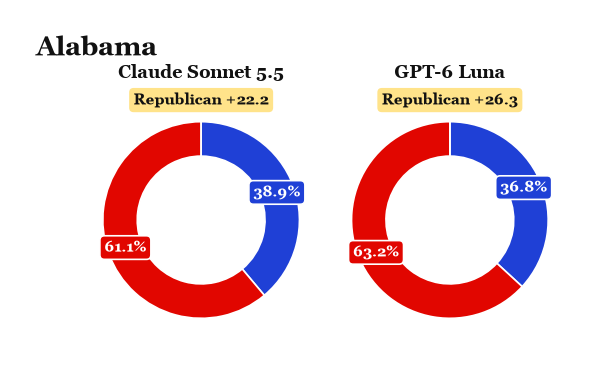{fig-alt="Donut charts for Alabama"}

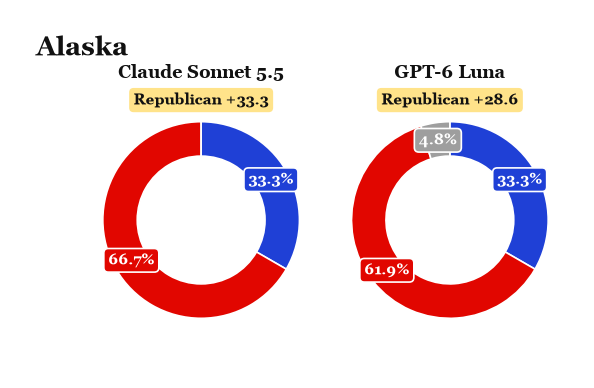{fig-alt="Donut charts for Alaska"}

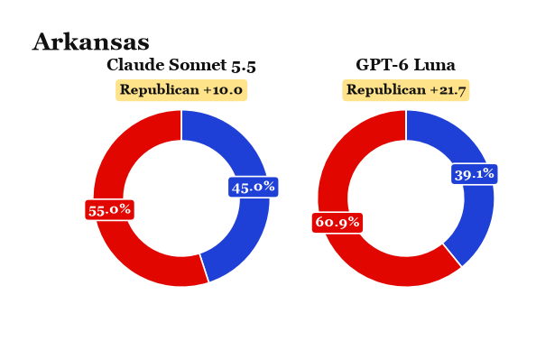{fig-alt="Donut charts for Arkansas"}

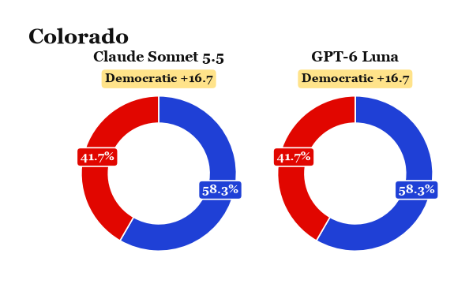{fig-alt="Donut charts for Colorado"}

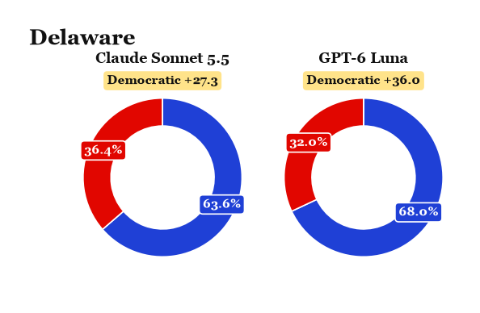{fig-alt="Donut charts for Delaware"}

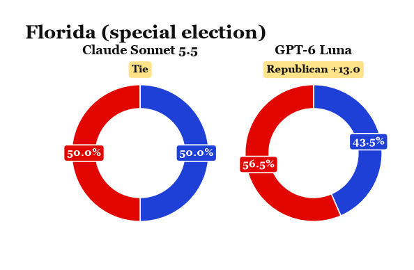{fig-alt="Donut charts for Florida (special election)"}

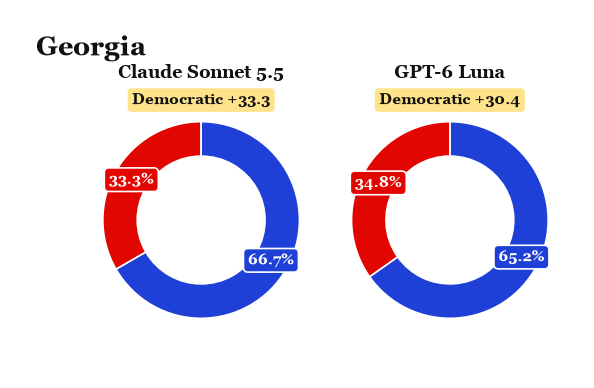{fig-alt="Donut charts for Georgia"}

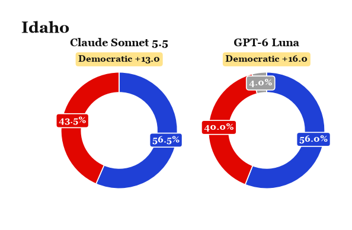{fig-alt="Donut charts for Idaho"}

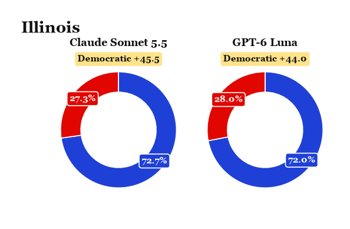{fig-alt="Donut charts for Illinois"}

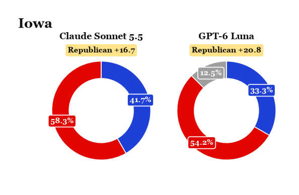{fig-alt="Donut charts for Iowa"}

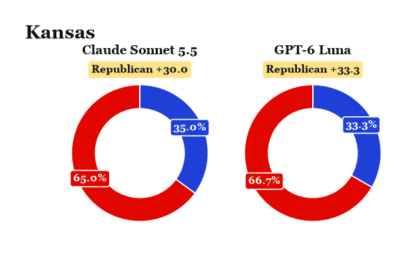{fig-alt="Donut charts for Kansas"}

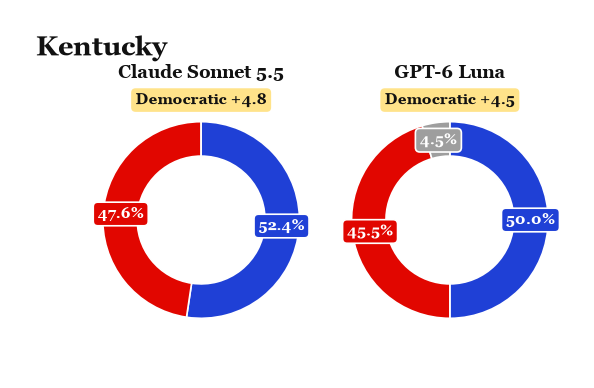{fig-alt="Donut charts for Kentucky"}

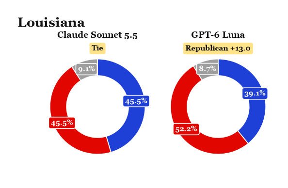{fig-alt="Donut charts for Louisiana"}

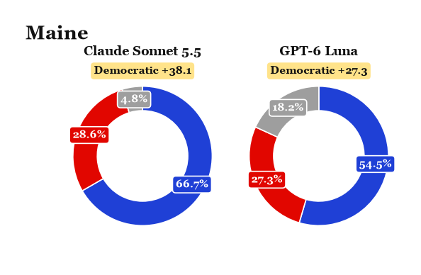{fig-alt="Donut charts for Maine"}

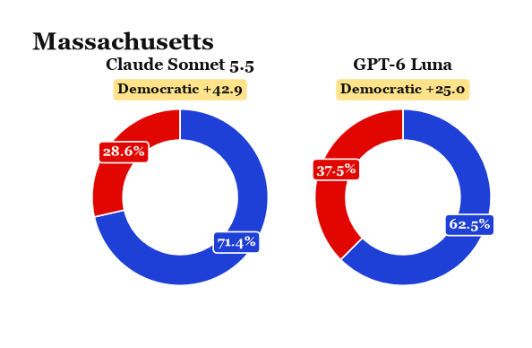{fig-alt="Donut charts for Massachusetts"}

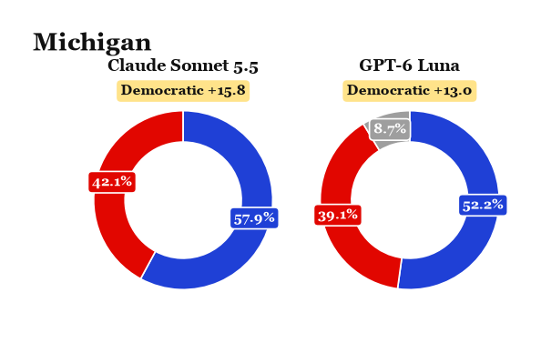{fig-alt="Donut charts for Michigan"}

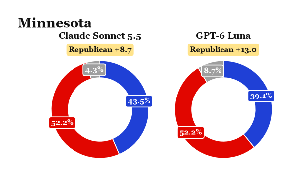{fig-alt="Donut charts for Minnesota"}

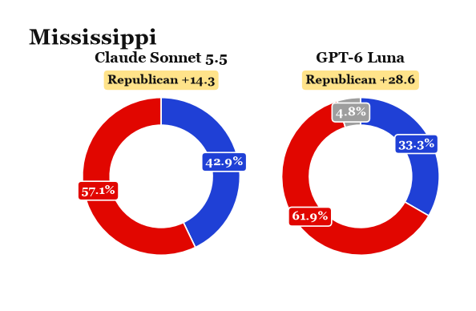{fig-alt="Donut charts for Mississippi"}

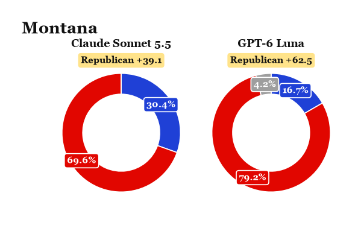{fig-alt="Donut charts for Montana"}

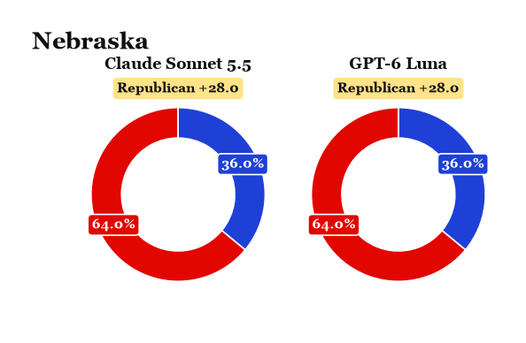{fig-alt="Donut charts for Nebraska"}

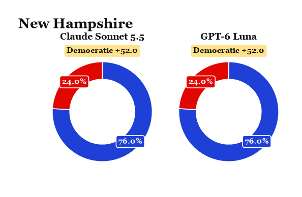{fig-alt="Donut charts for New Hampshire"}

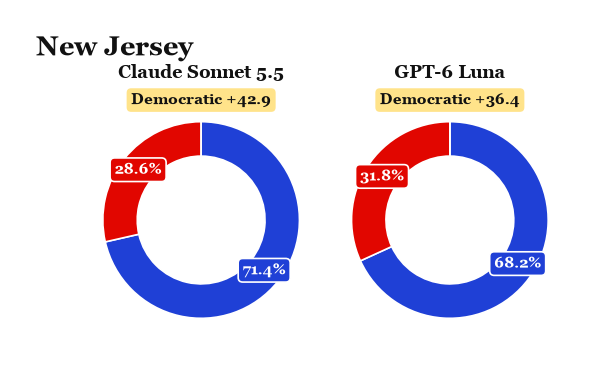{fig-alt="Donut charts for New Jersey"}

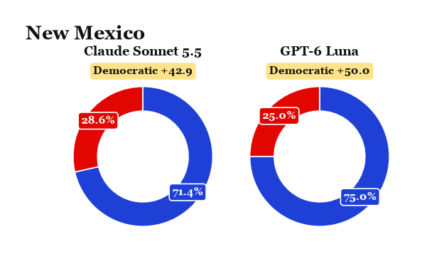{fig-alt="Donut charts for New Mexico"}

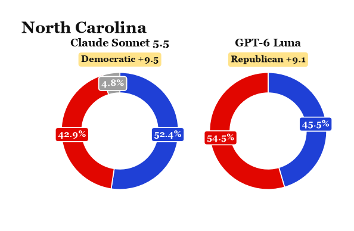{fig-alt="Donut charts for North Carolina"}

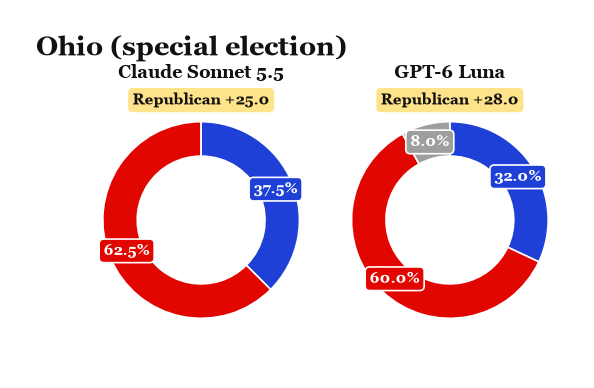{fig-alt="Donut charts for Ohio (special election)"}

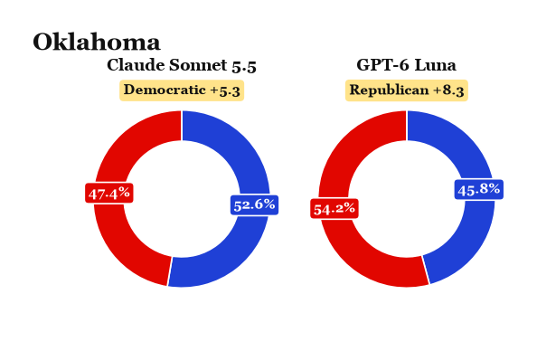{fig-alt="Donut charts for Oklahoma"}

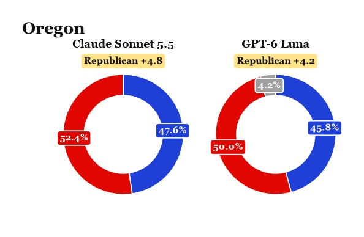{fig-alt="Donut charts for Oregon"}

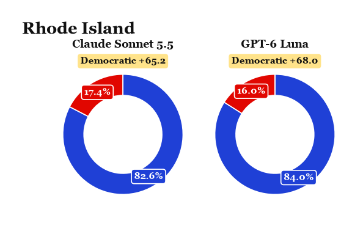{fig-alt="Donut charts for Rhode Island"}

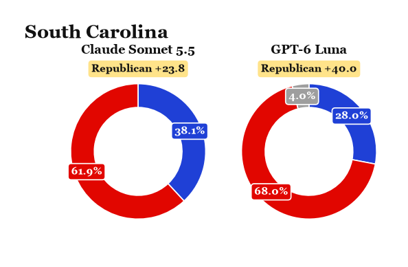{fig-alt="Donut charts for South Carolina"}

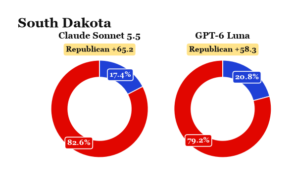{fig-alt="Donut charts for South Dakota"}

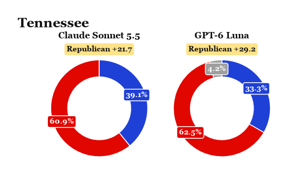{fig-alt="Donut charts for Tennessee"}

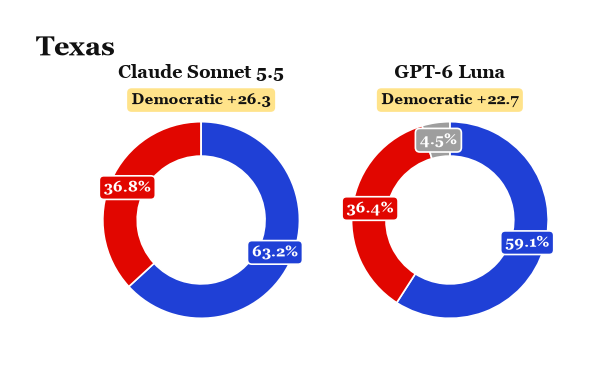{fig-alt="Donut charts for Texas"}

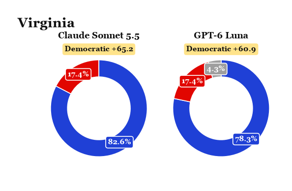{fig-alt="Donut charts for Virginia"}

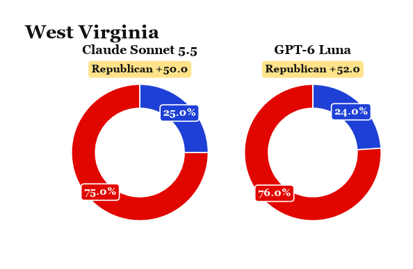{fig-alt="Donut charts for West Virginia"}

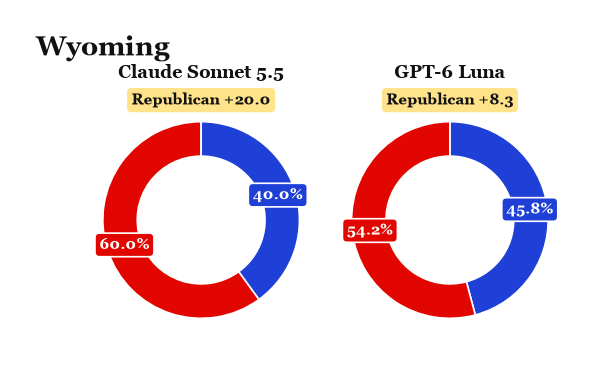{fig-alt="Donut charts for Wyoming"}

:::
