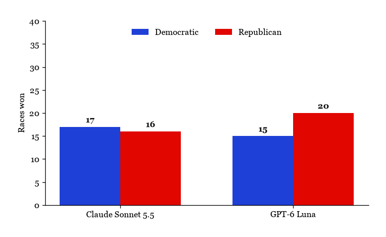

We forecast the 2026 U.S. Senate election, comprising Senate elections in 33 states and special Senate elections in 2 states. The 2025 CES ([Schaffner, Pope, and Shih (2026)](https://doi.org/10.7910/DVN/DFUGJR)) was used to create 25 synthetic personas per Senate state, and then 2 large language models were queried to forecast the votes for each race.

{fig-alt="Bar chart of the number of Senate seats each model gives to the Democrats and to the Republicans"}
Note that the Claude Sonnet 5.5 model gives a total of 33 races won instead of 35, due to 2 races being tied.

## Would you vote for the Democratic candidate, the Republican candidate, someone else, or would you not vote?

Each race is represented by a donut chart, showing the distribution of votes among the Democratic, Republican, and Other categories. Each race is made up of 25 synthetic personas, which were constructed by taking weighted samples of characteristics from the 2025 CES.





Here the total number of personas that would not vote is shown per model per state; however, these were not used to create the percentage of votes for each candidate.

## Results

We can see that the Anthropic model predicts a total of 17 states to elect a Democratic candidate, and 16 states to elect a Republican candidate, with 2 states ending in ties. The OpenAI model predicts a total of 15 states to elect a Democratic candidate, and 20 states to elect a Republican candidate. The states that differ are Florida, Louisiana, North Carolina, and Oklahoma. The Anthropic model predicts a tie in Florida and Louisiana and a Democratic win in North Carolina and Oklahoma, while the OpenAI model predicts a Republican win in all four. Overall, the Anthropic model gives more seats to the Democratic Party, and the OpenAI model gives more to the Republican Party.

## Models and API Costs

The two models used for this forecast were Claude Sonnet 5.5 from Anthropic and GPT-6 Luna from OpenAI. To perform the forecast, 875 queries were made to each model, for a total of 1,750 queries (one per persona). The Anthropic model used a total of 576,000 tokens, and the OpenAI model used a total of 326,000 tokens. The cost of the forecast was $1.44 for the Anthropic model and $0.08 for the OpenAI model, for a total of $1.52.

## Methods

To create the synthetic personas, we used the 2025 CES to find the proportions of gender, race, education, party, ideology, and whether they are registered voters of the populations of each state having a Senate seat election. By taking these totals, we were able to perform weighted samples on each characteristic, with replacement, to create 25 synthetic personas per state. 

Sampling with replacement allowed us to create personas that are representative of the population, due to the weights, but also not being constricted to the exact population surveyed, by sampling. The sample was used without post-stratification. This was due to the fact that the CES is already weighted to match the population of each state.

Each persona was then queried to find whether they would vote for the Democratic candidate, Republican candidate, Other candidate, or not vote at all. These responses were all cached, to avoid future queries to the models for the same data. The results were then aggregated to find the total number of votes for each candidate per state, with only the votes for the Democratic, Republican, and Other candidates being used to find the percentage of votes for each candidate, as any personas who would not vote were treated as if they did not vote.

The exact question asked to each persona was: "Would you vote for the Democratic candidate, the Republican candidate, someone else, or would you not vote?". This question was framed as between the parties, rather than the candidates, as the personas only have access to the CES and not to the news, candidate names would not help them compare the candidates with the party they represent. This was also done to match the CES, which asks about party preference rather than candidate preference.

Python was used throughout the entire process ([Python Software Foundation (2023)](https://www.python.org)), with the data mostly being stored in Parquet files ([Apache Software Foundation (2026)](https://parquet.apache.org)).

## Discussion

This forecast builds on the idea that a large language model can become a substitute for a human response. [Argyle et al. (2023)](https://doi.org/10.1017/pan.2023.2) trained GPT-3 on sociodemographic backstories taken from real surveys and found that its answers reproduced the same patterns as the responses from real respondents. Our approach mimics this by creating synthetic personas from the CES demographics and taking their responses to be representative of an actual population.

[Bisbee et al. (2024)](https://doi.org/10.1017/pan.2024.5) found that ChatGPT's averages could look close to the true ANES baseline, while the synthetic responses showed less variation than real responses, and that the wording of the prompt allowed changes in the results. Our design shares these same limitations. As we are only taking small samples of 25 personas per state, the small variation of synthetic responses leads us to make more extreme predictions than we would with a larger sample. Only one version of the prompt was given to the models, so the effect that the wording has on the results is unknown.

The results of this forecast are generally similar to the current state of the U.S. Senate, prior to the 2026 election, with both models predicting close results between the two parties, which is consistent with the current House. However, the Anthropic model predicts a more Democratic election, while the OpenAI model predicts a more Republican election, with the current House having a Republican majority.

Now this cannot be taken at face value, as over the last few years, the political landscape of the United States has been changing quickly, and that might affect on the election results, which this forecast does not take into account. Giving the models more information about the current political landscape may improve the results of the forecast, however, giving the correct information to the models is a difficult task, as the information chosen to be fed in may result in a bias towards one party or another. The way the information is presented to the models may also have an effect on the results. Asking the models additional questions may also help us understand the personas better and how they would vote. These responses may also be used to create more detailed and accurate models of the personas, which may improve the results of the forecast.

The results of this forecast are not meant to give an accurate prediction of the actual election outcome, due to the limited testing, scope, and resources available. However, this forecast does provide evidence that large language models can be used to create synthetic responses from personas that reflect real-world voting behavior. Further research is needed to improve the accuracy of these predictions and to understand the limitations of using large language models in this way.